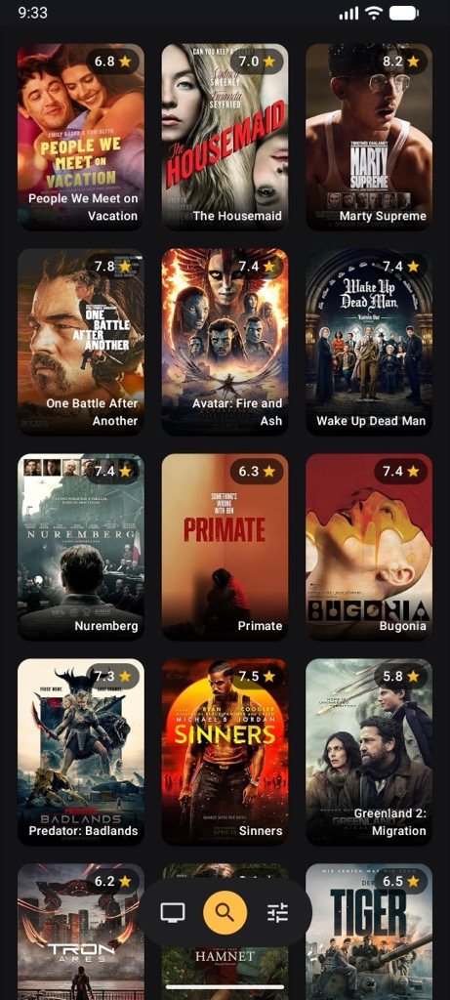
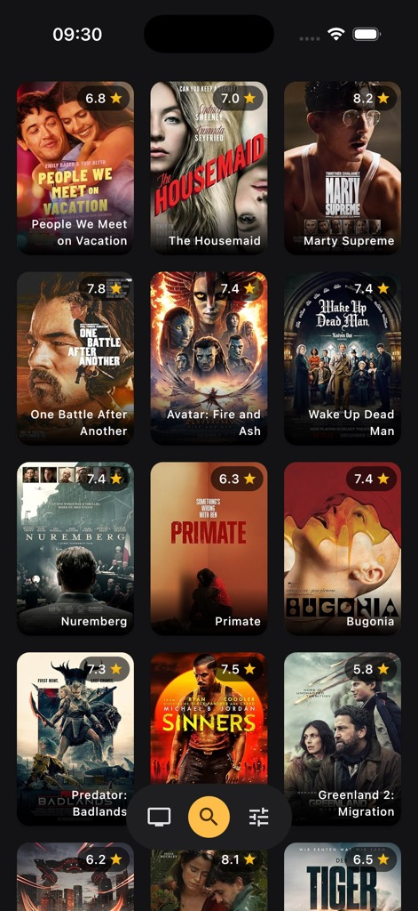
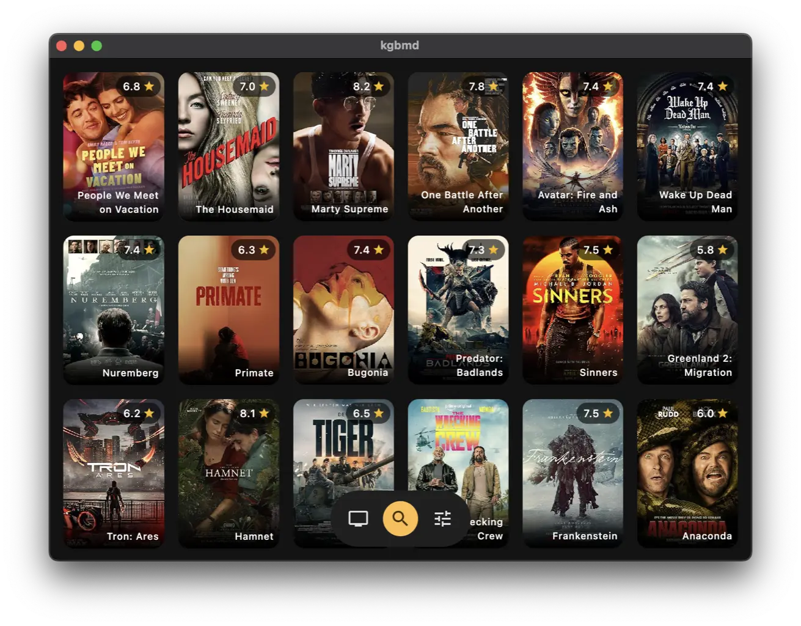

# kgbmd
## Konrad Biernacki (kgbier@gmail.com)

A movie browser written in Kotlin Multiplatform, with Compose Multiplatform UI

| Android                                             | iOS                                             | Desktop                                              |
|-----------------------------------------------------|-------------------------------------------------|------------------------------------------------------|
|  |  |  |

## Features
- Show the IMDB Hot 100 films/shows
- Search IMDB's database of films, shows and actors
- Find information on movies and shows, such as:
  - Top billed actors, creators, etc. including full cast and crew lists
  - Highest-rated episodes including full episode/season lists
  - Top watch option for your given Postcode

## Planned Features
- Awards data
- Box office/Budget data 
- List and link to available streaming providers
- Theatre showtimes
- GPS location alternative to Country/Postcode
